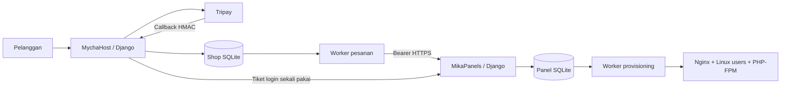

# Arsitektur dan kontrak API

## Komponen



Satu checkout kode, dua proses dengan `MIKA_SERVICE=panel|shop`. URL, database, secret key, cookie sesi/CSRF, dan admin model dibatasi sesuai service. Logika server dan installer semuanya Python. Frontend merupakan template server-rendered, CSS lokal, dan JavaScript kecil untuk konfirmasi tindakan; tidak ada bundler atau CDN yang wajib.

Root worker terpisah dari Gunicorn yang berjalan sebagai user `mika`. Kode installer/root worker dimiliki root di produksi. Token API adalah credential server-to-server, tidak pernah dimasukkan pada template pelanggan. Demo tidak membuat sistem user atau Nginx/PHP pool.

## API panel

Semua `/api/v1/` memerlukan `Authorization: Bearer <MIKA_API_TOKEN>`. Token yang sama disimpan privat pada panel dan toko. Gunakan HTTPS untuk komunikasi antar proses di produksi.

### POST `/api/v1/accounts/`

```json
{
  "external_id": "MH-unique-invoice",
  "customer_id": "stable-shop-user-id",
  "email": "customer@example.com",
  "plan": "stellar",
  "domain": "customer.example.com",
  "kind": "php",
  "days": 30
}
```

Engine `php` atau `static`, plan aktif harus ada, domain tervalidasi, durasi 1–366 hari. `external_id` merupakan idempotency key. Permintaan berulang dengan identitas sama mengembalikan akun yang sama tanpa job tambahan; perubahan parameter menghasilkan 409. Domain lain yang sudah terdaftar juga 409. Identitas customer stabil dipetakan ke akun panel dengan password tidak dapat dipakai; masuk melalui SSO toko.

Respons mencakup ID, external ID, domain, status, kind, plan, expires_at, server_ip, dan mode (`demo|system`). Respons 201 berarti job diantrekan, bukan website sudah selesai dipasang.

### GET `/api/v1/accounts/<external_id>/`

Mengembalikan status akun; 404 jika belum tersedia. API hanya untuk server toko/operator yang memiliki token, bukan browser publik.

### POST `/api/v1/accounts/<external_id>/sso/`

Untuk akun aktif. Mengembalikan token acak yang disimpan sebagai SHA-256, berlaku 60 detik, dan sekali pakai. MychaHost menyajikan tombol form POST menuju `/sso/` panel. Token tidak ada di query string. Panel memeriksa Origin persis terhadap `MYCHA_PUBLIC_URL`; konsumsi token memakai update bersyarat sehingga replay ditolak.

## State dan pemulihan

- Invoice: unpaid → pending → paid → active. Timeout create → review. Expired/failed bukan bukti paid; callback terlambat yang sah dapat mengonfirmasi pembayaran. Refund → review.
- Akun: queued → active atau failed. Admin dapat suspend/resume; worker menangguhkan akun yang masa aktifnya habis.
- Job: pending → running → done/failed. Worker tunggal memakai file lock. Recovery setelah restart mengembalikan job running ke pending; provisioning create mempertahankan file website yang sudah ada.
- Dua database bukan transaksi atomik bersama. External ID stabil dan retry pesanan berbayar mencegah kehilangan pembayaran ketika panel offline. Callback tidak menjalankan perintah sistem.

Domain pada order disimpan unik termasuk riwayat gagal untuk menghindari bentrok akibat callback pembayaran terlambat. Penggunaan ulang domain memerlukan tindakan operator yang memahami rekonsiliasi; tidak tersedia recycle domain otomatis.

## Keamanan dan batas isolasi

Django menyediakan password hashing, validasi password, CSRF pada form, escaping template, secure cookie produksi, dan perlindungan clickjacking. Login dibatasi per username setelah 10 kegagalan dalam 15 menit. Callback gateway dan SSO adalah pengecualian CSRF terarah, digantikan signature raw-body atau token sekali pakai + validasi Origin.

File manager hanya menangani file reguler pada root public. Operasi menggunakan directory descriptor dan `O_NOFOLLOW`, memblokir traversal, symlink, serta file khusus. Upload maksimal 10 MB; backup root maksimal 50 MB. Pengukuran storage bersifat batas upload aplikasi, bukan hard quota filesystem.

PHP berjalan sebagai user per situs dengan pool terpisah, memory limit, jumlah proses, temporary directory, `open_basedir`, dan sejumlah fungsi eksekusi dinonaktifkan. Ini tidak mengisolasi kernel/network dan tidak memberi jaminan sandbox terhadap pelanggan berbahaya. Gunakan isolasi tambahan sebelum menawarkan hosting umum. Belum ada MFA, password reset email, resource accounting OS, penghapusan tenant otomatis, atau pengelolaan database pelanggan.

Koneksi Tripay memakai TLS terverifikasi; dependency lock mencantumkan hash SHA-256 dari PyPI. Konfigurasi privat tidak boleh masuk Git. Perubahan jaringan cloud tersimpan sebagai draft dan bukan publikasi lingkungan.
